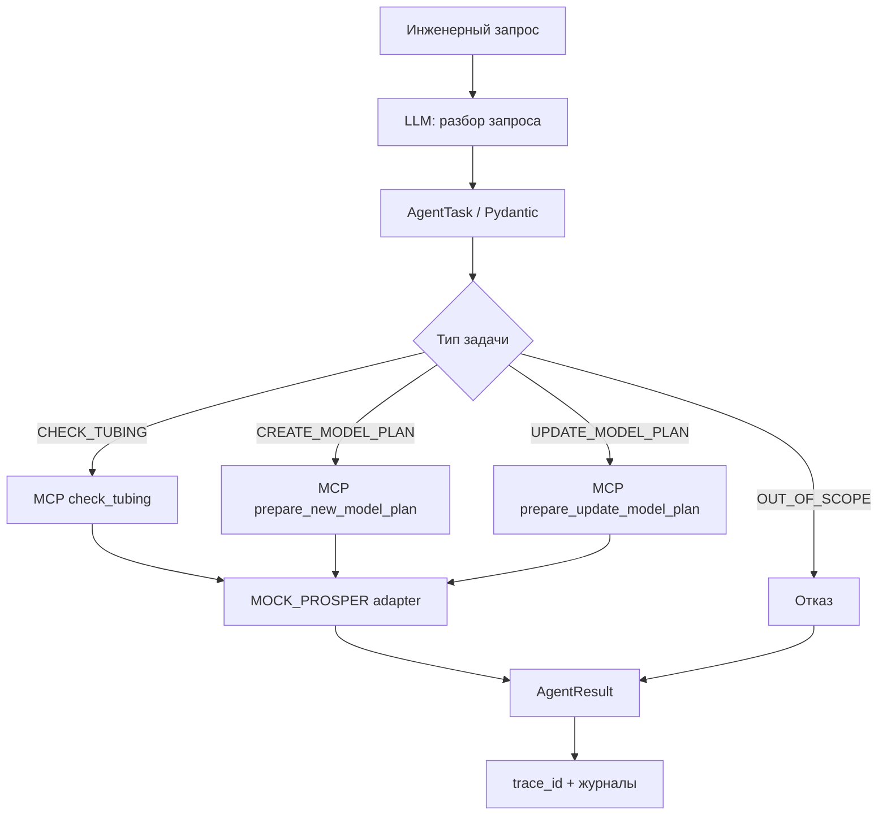

# Архитектура агента НИР-4 — PROSPER

## 1. Демонстрационная архитектура



Это уже рабочий контур агента. Реальный PROSPER/OpenServer отсутствует, поэтому MCP-адаптер помечает результат `integration_status=NOT_CHECKED`.

## 2. Где находится LLM

`src/agent/loop.py` выполняет:

1. принимает естественно-языковой запрос;
2. отправляет его в OpenAI Responses API с системной инструкцией и JSON Schema;
3. получает `AgentTask`;
4. валидирует его Pydantic;
5. выбирает MCP-инструмент;
6. возвращает `AgentResult`.

При отсутствии ключа или при ошибке LLM допускается fallback только для демонстрации локального контура. В журнале это видно как `offline_fallback`.

## 3. MCP-слой

`src/agent/mcp_server.py` содержит MCP tools:

- `check_tubing` — предметная проверка OD/ID/wall;
- `prepare_new_model_plan` — mock-план создания New;
- `prepare_update_model_plan` — mock-план изменения Rep.

Все инструменты возвращают `trace_id` и журналируют аргументы/ответ.

## 4. Что заменяется при подключении PROSPER

Mock-реализация не должна маскироваться под реальный расчёт. После предоставления PROSPER/OpenServer меняется нижний слой:

```text
Agent
  ↓
MCP tool
  ↓
PROSPER MCP adapter
  ↓
OpenServer
  ↓
PROSPER
```

Агентный цикл, схемы, подтверждение и журнал остаются отдельными от ПО.

## 5. Соответствие требованиям задания

- типизированная задача — `AgentTask`;
- валидация — Pydantic;
- MCP — FastMCP;
- единый ответ — `AgentResult`;
- traceability — `trace_id`;
- журнал LLM — `logs/llm_calls.jsonl`;
- журнал агента — `logs/agent_runs.jsonl`;
- журнал MCP — `logs/mcp_calls.jsonl`;
- отказ при запросе вне области — `OUT_OF_SCOPE`;
- отсутствие обязательных входов — `MISSING_INPUT`;
- недоступность реального ПО — явно отражается как `NOT_CHECKED`.

## 6. Что пока не заявляется как выполненное

Не заявляются:

- реальный запуск PROSPER;
- реальная запись модели;
- обратное чтение параметров из PROSPER;
- воспроизведение расчёта в реальном ПО;
- соответствие реальным промысловым замерам.

Это будет следующим этапом после предоставления установленной версии PROSPER/OpenServer и подтверждённого API.
