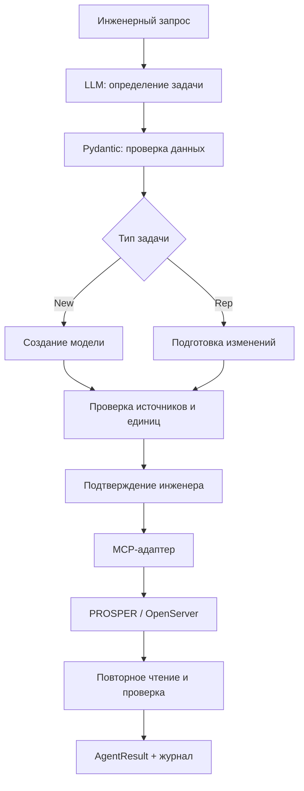
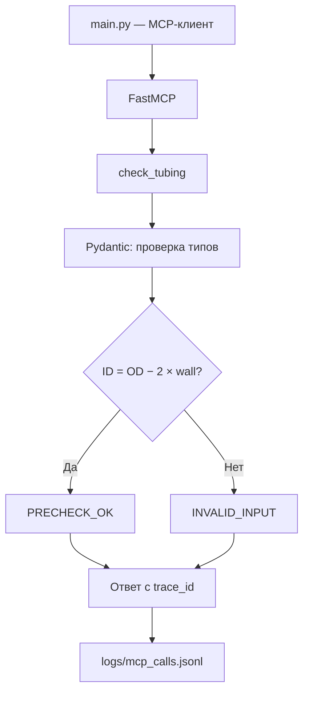

# Архитектура агента НИР-4 — PROSPER

## 1. Целевая архитектура

Проект предназначен для автоматизации создания и обновления моделей скважин в PROSPER.

Планируются два сценария:

- **New** — создание новой модели по исходным инженерным документам.
- **Rep** — подготовка изменений существующей модели после ремонта.

**Статус:** целевая архитектура, ещё не реализована полностью.

## 2. Реализованный MCP-прототип

В настоящий момент работает инструмент `check_tubing` для проверки геометрии НКТ.

## 3. Структура кода

- `main.py` — запуск демонстрации MCP.
- `src/agent/mcp_server.py` — регистрация инструмента FastMCP, проверка НКТ и журнал.
- `src/agent/schemas.py` — схемы Pydantic.
- `src/agent/tools.py` — учебные инженерные функции Vogel и Arps.
- `tests/test_agent.py` — проверки успешного и ошибочного вызовов.
- `agent.py` — будущая точка входа агента.

## 4. Контракт MCP-инструмента

`check_tubing` принимает идентификатор скважины, наружный диаметр, толщину стенки и внутренний диаметр.

Все размеры задаются в миллиметрах.

Проверяется:

`ID = OD − 2 × wall`

Результат включает статус, идентификатор скважины, уникальный `trace_id`, расчётные данные или причину отказа.

## 5. Журналирование

Каждый вызов создаёт запись JSONL:

- время обращения;
- `trace_id`;
- название инструмента;
- исходные аргументы;
- возвращённый ответ.

Идентификатор `trace_id` связывает ответ MCP с записью журнала.

## 6. Текущие ограничения

Текущий MCP-прототип использует синтетические данные и локальные проверки Python.

Он не выполняет расчёты PROSPER, не сохраняет модели скважин и не проверяет физическую точность результатов.

Интеграция с PROSPER/OpenServer: **не проверена из-за отсутствия доступного ПО**.

Разбор естественного языка через LLM, цикл LangGraph и подтверждение изменений также относятся к следующему этапу разработки.